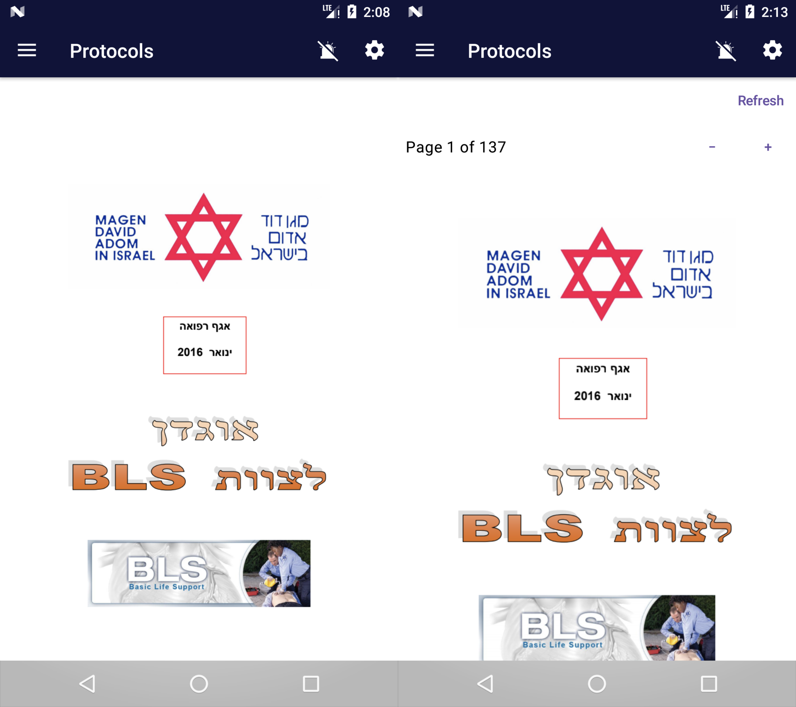

# Deferred viewer controls — issue #145

Left: published native12822. Right: historical Kotlin `3f7644b1`, not the current
release. Added Refresh, page1of137 and zoom rows lower the BLS cover and clip its
bottom at the viewport edge. Viewer chrome/viewport work is deferred outside M2
under [#145](https://github.com/atlowChemi/MyMada/issues/145). This image documents
the retained difference, not a fix or zoom/interaction equivalence.

Unmodified source: `parallel-visual-audit/medical-dispositions/pair-F3-BLS.png`.
SHA256: `93151ebd66f8f6aeea84c7b5ea9cc08a7b3880c292feffaab63181b0e4c9802e`.
The retained `source-image-sha256.txt` binds the original native
`production12822-BLS-approved-assets.png` and candidate `final-release24-BLS-live.png`.
No new capture, application change or build was needed for this publication.
